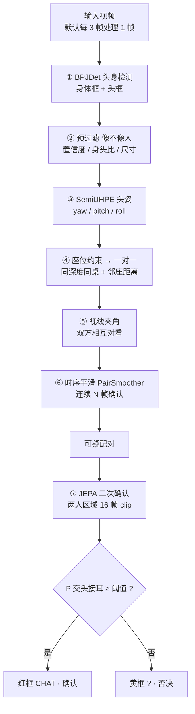

# 交头接耳检测（Chatting Detection）

基于教室监控视频，自动识别「相邻两人转头相互对看、疑似交头接耳」的行为。

核心思路是 **两段式**：第一段用几何 + 视线规则快速抓「可疑配对」，第二段可选用自训练的 V-JEPA 模型判定真伪。设计取舍是 **宁可漏检，不要误判**。

> 技术栈：Python + PyTorch · BPJDet 头身检测 · SemiUHPE 头姿估计 · 可选 V-JEPA 二次确认

---

## 效果与输出

标注结果视频中：

| 标注 | 含义 |
|---|---|
| 🔴 红框 `CHAT` | 视线夹角可疑 **且**（若开启）JEPA 确认 → 判定为交头接耳 |
| 🟡 黄框 `?` | 视线夹角可疑但被 JEPA 否决 → 不判为交头接耳 |

运行结束会打印统计：`原始 N 对次 → 可疑 M 对次 → JEPA确认 K 对次`。

---

## 判别逻辑



完整的参数含义、调参历史和踩坑记录见 **[`docs/交头接耳检测判别逻辑.md`](docs/交头接耳检测判别逻辑.md)**。

### 座位约束（关键设计）

摄像头是斜俯视角，**画面里的「上下」≠ 教室里的「前后」**，按图像坐标判「同排邻座」会漏检。

因此默认 `SEAT_MODE = "depth"`：**用头的大小代表深度**——同桌相邻的人离镜头一样远，头一样大；前后排深度差明显，头大小差得多。这个判据与摄像头角度、桌子摆法都无关。

---

## 目录结构

```
.
├── SemiUHPE-main/          # 主工程（SemiUHPE 头姿 + BPJDet 检测 + 推理入口）
│   ├── video.py            # ★ 交头接耳检测主入口
│   ├── image.py            # 单张图片推理
│   ├── predict.py          # 预测脚本
│   ├── train.py / eval.py  # 训练与评估
│   ├── src/                # SemiUHPE 网络与 Fisher 分布实现
│   ├── utils/              # YOLOv5 系工具函数
│   ├── models/             # 检测模型定义
│   ├── settings/           # 各数据集配置 yml
│   └── weights/links.txt   # 权重下载链接
├── _dataset/               # 数据集构建与标注工具
│   ├── label_server.py     # 标注服务
│   ├── label.html          # 标注页面
│   ├── sample_pairs.py     # 配对采样
│   ├── track_heads.py      # 头部跟踪
│   └── _diag_*.py          # 各类诊断脚本
├── _diag/                  # 阶段性诊断与预览脚本
├── docs/                   # 设计文档
└── mcp_zhipu_vision/       # 智谱视觉模型 MCP server（看图辅助）
```

> `turnhead/`（转头识别）是另一个独立工程，自带依赖备份和大量测试数据，**不在本仓库内**。
>
> `_dataset/` 下的诊断脚本统一通过 `import video as V` 复用主逻辑；由于它们都会先导入
> `sample_pairs`，而 `sample_pairs` 会把 `SemiUHPE-main/` 加入 `sys.path`，
> 因此解析到的是 `SemiUHPE-main/video.py`，与根目录无关。

---

## 快速开始

### 1. 环境

- Python 3.10+
- PyTorch（建议 CUDA 版本）
- 其他依赖：

```bash
pip install -r requirements.txt
```

### 2. 模型权重

权重文件体积大，**不在仓库内**，需自行下载后放入 `SemiUHPE-main/weights/`：

| 权重 | 用途 |
|---|---|
| `DAD-COCOHead-ResNet50-best.pth` | SemiUHPE 头姿估计主干 |
| `ch_head_l_1536_e150_best_mMR.pt` | BPJDet 头身检测 |

下载链接见 [`SemiUHPE-main/weights/links.txt`](SemiUHPE-main/weights/links.txt)。

### 3. 运行

```bash
cd SemiUHPE-main
python video.py --video-dir /path/to/videos --output-dir ./outputs
```

也可以用环境变量指定路径：

```powershell
$env:CHATTING_VIDEO_DIR  = "D:\video\1\1\right\cutting_video"
$env:CHATTING_OUTPUT_DIR = "D:\chatting\outputs"
python SemiUHPE-main\video.py
```

- `--video-dir` 可以是**视频目录**（处理其中所有 `.mp4`）或**单个视频文件**
- 结果视频输出到 `--output-dir`，命名 `<原文件名>_chat.mp4`

> **注意**：`VIDEO_DIR` / `OUTPUT_DIR` 不再写死本机绝对路径。若你升级前用的是旧版，请改用上面的命令行参数或环境变量，否则会默认去找 `./videos` 和 `./outputs`。

---

## 主要参数

都在 `SemiUHPE-main/video.py` 顶部的【参数】区。按对结果影响从大到小：

| 参数 | 当前值 | 含义 |
|---|---|---|
| `GAZE_OBTUSE_THRESH` | `70.0` | ★ 视线夹角阈值（度）。主要闸门，调高更严 |
| `SEAT_DIST_RATIO` | `3.5` | 邻座判定：两人距离 ≤ 该倍数 × 平均头高 |
| `SEAT_DEPTH_RATIO_MAX` | `1.20` | 同桌判定：两人头高比 ≤ 该值（头的大小 = 深度） |
| `SMOOTH_CONFIRM_FRAMES` | `2` | 时序确认帧数，压单帧偶发误判 |
| `HEAD_CONF_THRESH` | `0.65` | 人头置信度，压误检 |
| `MIN_TURN_YAW` | `7.0` | 每人至少转头的角度（度） |
| `FRAME_SKIP` | `3` | 每 3 帧处理 1 帧，提速用 |
| `JEPA_ENABLE` | `False` | 是否开启第二阶段 JEPA 确认 |

### 开启第二阶段（JEPA）

JEPA 代码与权重不随本仓库分发，需要用环境变量指过去：

```powershell
$env:JEPA_ROOT     = "D:\jepa-main"
$env:JEPA_BACKBONE = "D:\jepa-main\pretrained_weights\vitl16.pth.tar"
$env:JEPA_HEAD     = "D:\jepa-main\pretrained_weights\video_classification_frozen\ssv2-16x2x3\jepa-best.pth.tar"
```

然后把 `JEPA_ENABLE` 改为 `True`。

> ⚠️ 两人区域裁剪规格（`PAIR_CROP_K` / `PAIR_CROP_DY` / `PAIR_PREP_SIZE` / `PAIR_INPUT_SIZE`）
> **必须与训练时完全一致**，否则 P 值会随裁剪区域大小漂移、阈值失去意义。

---

## 已知限制

- JEPA 分类头权重目前**已确认失效**，正在用新数据集重训；默认 `JEPA_ENABLE = False`，只跑第一阶段几何 + 视线判定。
- 参数是在特定教室机位下调优的，换场景需要重新标定（尤其是 `GAZE_OBTUSE_THRESH`）。
- 人物 ID 是 IOU tracker 的临时编号，**不是身份识别**；遮挡、交叉可能造成 ID 切换。

---

## 许可证

本项目基于 [SemiUHPE](https://github.com/SeaEagleI/SemiUHPE) 与 [BPJDet](https://github.com/HCIC-LYS/BPJDet)（均为 GPLv3）修改而来，因此同样采用 **GPLv3**。

详见 [`LICENSE`](LICENSE)。上游许可证原文保留在 `SemiUHPE-main/LICENSE.txt`。

## 致谢

- [SemiUHPE](https://github.com/SeaEagleI/SemiUHPE) — 半监督无标定 3D 头部姿态估计
- [BPJDet](https://github.com/HCIC-LYS/BPJDet) — 基于身体部位联合的头身检测
- [YOLOv5](https://github.com/ultralytics/yolov5) — 检测框架基础
