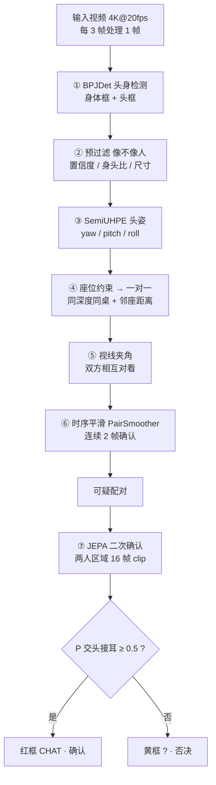

# 交头接耳检测 · 判别逻辑说明

> 版本：精简版 v1（两段式）
> 入口脚本：`SemiUHPE-main/video.py`
> **本文档已于 2026-10-09 与代码同步**（此前版本记录的是 `GAZE_OBTUSE_THRESH=100`、
> `MIN_TURN_YAW=10` 和已废弃的 `ROW_Y_RATIO` / `NEAR_DX_RATIO` 判据，均已过时）

---

## 一、总体设计：两段式

核心思路是「**第一段只负责抓可疑，第二段只负责判真伪**」，设计原则为**宁可漏检，不要误判**。

- **第一段（几何 + 视线）**：用头身检测、座位约束、视线夹角等传统几何规则，快速筛出「可疑配对」。这一步宁可多抓、不可漏抓。
- **第二段（JEPA）**：把可疑配对的「两人区域」裁剪成 16 帧 clip，喂给自训练的 V-JEPA 二分类模型，判断是否真的在交头接耳。只有 JEPA 也判定为「交头接耳」才最终确认。
  > ⚠️ **第二段当前默认关闭**（`JEPA_ENABLE = False`），见 [第三节](#三第二段jepa-判真伪确认)。



---

## 二、第一段：几何 + 视线（抓可疑）

### ① BPJDet 头身联合检测

YOLOv5-L（CrowdHuman 训练），检测「身体」和「长在身体上的头」。

| 参数 | 值 | 说明 |
|---|---|---|
| `IMGSZ` | 960 | 推理尺寸 |
| `CONF_THRES` | 0.50 | NMS 置信度阈值 |
| `IOU_THRES` | 0.75 | NMS IoU 阈值 |
| `MATCH_IOU_THRES` | 0.6 | 头框与身体框的关联 IoU |
| `NUM_OFFSETS` | 2 | 部位偏移数（身体 / 头） |
| `DEVICE` | `cuda:0` | 推理设备 |

### ② 预过滤「像不像人」（防椅子靠背被当人头）

| 条件 | 默认值 |
|---|---|
| 人头置信度 `HEAD_CONF_THRESH` | ≥ 0.65 |
| 身体置信度 `BODY_CONF_THRESH` | ≥ 0.62 |
| 身体最小高/宽 `MIN_BODY_HEIGHT` / `MIN_BODY_WIDTH` | 50 / 30 像素 |
| 身头比 `BH_RATIO_MIN` ~ `BH_RATIO_MAX`（身体高 ÷ 头高） | 2.5 ~ 8.0 |
| 头宽占图宽 `HEAD_MIN_RATIO` ~ `HEAD_MAX_RATIO` | 0.015 ~ 0.35 |
| 头位置 | 在身体上半部、贴近身体顶部、水平不超出身体 ±25% |

### ③ SemiUHPE 头姿估计

ResNet50 + Fisher 分布，输出 `yaw / pitch / roll`。

> 符号约定：`ya = -yaw`（`YAW_SIGN = -1`），**ya > 0 = 向左看，ya < 0 = 向右看**。

### ④ 座位约束 → 一对一匹配

#### 为什么不能用图像坐标判「同排」

摄像头是**斜俯视角**，画面里的「上下」≠ 教室里的「前后」：同一张桌子的相邻两人在画面里是斜着排列的，
按图像坐标判「同排 / 左右相邻」会被误判成前后排而**大量漏检**。

因此默认改用 `SEAT_MODE = "depth"`：**用头的大小代表深度**。

| 参数 | 值 | 含义 |
|---|---|---|
| `SEAT_MODE` | `"depth"` | ★ 同深度即同桌（推荐，与摄像头视角无关）<br/>`"desk"` = 桌线法（规则教室，见下） |
| `SEAT_DEPTH_RATIO_MAX` | `1.20` | ★ 同桌判定：两人头高比 ≤ 该值 |
| `SEAT_DIST_RATIO` | `3.5` | ★ 邻座判定：两人距离 ≤ 该倍数 × 平均头高（尺度无关） |

**为什么头的大小就是深度**：同桌相邻的人离镜头一样远 → 头一样大（比值 ≈ 1.0~1.1）；
前后排的人深度差明显 → 头大小差得更多（实测 ≥ 1.2）。这个判据与摄像头斜不斜、桌子怎么摆都无关。

> 📌 **2026-09-29 调整**：`SEAT_DIST_RATIO` 3.0 → 3.5。缩放截图 / 近镜头下邻座距离偏大，3.0 会漏。
> 肩并肩头距 ≈ 2 × 头高，3.5 对真邻座仍安全，隔一桌（≈ 4 × 头高）仍挡得住。

#### 备选：桌线法（`SEAT_MODE = "desk"`）

人坐着不动 → 把整段视频所有人的「脚点」（身体框底部中心 ≈ 椅子位置）累积起来，用 RANSAC 拟合桌线：
真实桌线支持点多，巧合共线是零星的。两人同桌 = 存在一条桌线同时经过两人脚点，且沿桌距离 ≤ 邻座上限。

| 参数 | 值 | 含义 |
|---|---|---|
| `DESK_ANGLE_MANUAL` | `None` | 手动指定桌向角（度）；`None` = 自动拟合 |
| `DESK_ROW_RATIO` | 0.9 | 脚点到桌线的垂直偏移 ≤ 该倍数 × 平均头高 |
| `DESK_NEAR_RATIO` | 3.0 | 同一桌线上两人沿桌距离 ≤ 该倍数 × 平均头高 |
| `DESK_LINE_INLIER` | 0.8 | 拟合桌线时的内点距离（× 中位头高） |
| `DESK_MIN_LINE_PTS` | 40 | 一条桌线至少要积累的脚点数（过滤巧合共线） |
| `DESK_MIN_FEET` | 60 | 脚点总数少于该值时暂用 depth 判据兜底（视频开头） |
| `DESK_POINTS_MAX` | 4000 | 脚点缓冲上限（滚动覆盖） |
| `DESK_REEST_INTERVAL` | 30 | 每隔多少个处理帧重新拟合一次桌线 |
| `DESK_MAX_LINES` | 4 | 最多拟合几条桌线（房间里有几排桌子） |
| `HEAD_SIZE_RATIO_MAX` | 1.5 | 头高比上限（深度兜底），桌线还没拟合出来时也用它 |

#### 视线夹角（相互对看）

| 参数 | 值 | 含义 |
|---|---|---|
| `GAZE_OBTUSE_THRESH` | **70.0** | 视线夹角 ≥ 该值判为「相互对看」 |
| `MIN_TURN_YAW` | **7.0** | 每人都至少转头 7°（没转头不可能在说话） |
| 方向检查 | — | 左者向右看（ya<0）、右者向左看（ya>0），双方都朝对方 |

> 📌 **2026-09-29 调整**：`GAZE_OBTUSE_THRESH` 100 → 80 → **70**。
> 4 个真实交谈样本实测 92~141°；「快要对上」的临界样本 76.4° 也要能过，100° 会漏检。
>
> 📌 **2026-09-29 调整**：`MIN_TURN_YAW` 10 → **7**。
> 教室监控 / 俯身辅导样本里有人只转头 7.7~8.2°，10° 会把夹角已达标的对子卡住。

**一对一匹配**：按夹角降序贪心，一个人只配一个人。

### ⑤ 时序平滑 `PairSmoother`（跨帧确认，不用追踪器）

靠头中心就近认领「同一个配对」，压掉单帧偶发误判。

| 参数 | 值 | 含义 |
|---|---|---|
| `SMOOTH_ENABLE` | `True` | 关闭即退回「单帧命中即输出」 |
| `SMOOTH_CONFIRM_FRAMES` | 2 | 同一配对连续命中 2 个处理帧才确认 |
| `SMOOTH_HOLD_FRAMES` | 2 | 确认后容忍 2 帧漏检（防闪烁） |
| `SMOOTH_MATCH_DIST` | 0.8 | 跨帧匹配上限 = 0.8 × 平均头高 |

产出结果：**「可疑配对」**，附带稳定 `track_id`。

---

## 三、第二段：JEPA 判真伪（确认）

> ⚠️ **当前默认关闭**：`JEPA_ENABLE = False`（2026-09-29 起暂时关闭，只保留第一阶段视线夹角判定）。
> 原因是分类头权重已确认失效，正在用新数据集重训。

### ⑥ JEPA 二次确认

| 参数 | 值 | 含义 |
|---|---|---|
| `JEPA_ENABLE` | **`False`** | 关闭即退回只靠视线夹角的旧版 |
| `JEPA_CONFIRM_THRESH` | 0.5 | P(交头接耳) ≥ 该值才最终确认 |
| `JEPA_FRAMES` | 16 | 采样帧数 |
| `JEPA_FRAME_STEP` | 4 | 帧步长，16×4=64 帧 ≈ 3.2 秒时间窗 |
| `JEPA_BUF_MAX` | 64 | 720p 帧缓冲上限（原始帧数） |
| `JEPA_RERUN_INTERVAL` | 60 | 同一配对每隔 60 帧才重跑一次 JEPA（节流） |
| `PAIR_CROP_K` | 5.0 | 两人区域正方形边长 = 5.0 × 平均头高 |
| `PAIR_CROP_DY` | 0.18 | 裁剪框中心下移 0.18 × 边长（多纳入身体） |
| `PAIR_PREP_SIZE` | 256 | 裁剪区统一缩放到的边长 |
| `PAIR_INPUT_SIZE` | 224 | JEPA 实际输入边长（256 中心裁 224） |

**模型**：V-JEPA(vit_large) 冻结主干 + AttentiveClassifier 分类头，二分类 `chatting`（交头接耳）/ `not_chatting`（正常）。

JEPA 代码与权重**不随本仓库分发**，用环境变量指过去（`JEPA_ENABLE = True` 时必须设置 `JEPA_ROOT`）：

| 环境变量 | 含义 |
|---|---|
| `JEPA_ROOT` | V-JEPA 代码根目录（`src/` 在这里） |
| `JEPA_BACKBONE` | 冻结主干权重，默认 `$JEPA_ROOT/pretrained_weights/vitl16.pth.tar` |
| `JEPA_HEAD` | 分类头权重，默认 `$JEPA_ROOT/pretrained_weights/video_classification_frozen/ssv2-16x2x3/jepa-best.pth.tar` |

> ⚠️ **两人区域规格（2026-09-27 修正）**：原本是「身体框并集 + 外扩 25%」，与训练数据的取景口径不一致，
> 且随两人距离变化 —— 这是第二阶段失效的直接原因（实测 P 值随裁剪区域变小单调飙升：
> 整幅 0.06 → 25% 区域 0.67 → 12% 区域 0.88，阈值完全失去意义）。
> 现改为**固定规格正方形**：以两头中心连线中点为心、边长 = `PAIR_CROP_K` × 平均头高。
> 边长只跟头高有关 → 取景尺度恒定，训练与推理两侧复用同一个函数 `video.pair_region()`
> 和同一条预处理链 `video.pair_prep()`（256 → 中心裁 224 → 归一化）。

---

## 四、最终输出

| 标注 | 含义 |
|---|---|
| 红框 `CHAT` | 视线夹角可疑 +（若开启）JEPA 确认 → 判定为交头接耳 |
| 黄框 `?` | 视线夹角可疑但被 JEPA 否决 → 不判为交头接耳 |

> 由于 `JEPA_ENABLE = False`，**当前不会产出黄框**，所有可疑配对都直接输出为红框 `CHAT`。

输出统计：`原始 N 对次 → 可疑 M 对次 → JEPA确认 K 对次`。

结果视频输出到 `--output-dir`，命名 `<原文件名>_chat.mp4`，高度 `SAVE_HEIGHT = 720`。

---

## 五、调节优先级

按对结果影响从大到小：

1. `GAZE_OBTUSE_THRESH`（**70°**，第一段主要闸门，实测范围 70~130）
2. `SEAT_DEPTH_RATIO_MAX`（**1.20**，同桌判定，调大更松）
3. `SEAT_DIST_RATIO`（**3.5**，邻座判定，× 平均头高）
4. `SMOOTH_CONFIRM_FRAMES`（2，时序确认帧数）
5. `HEAD_CONF_THRESH`（0.65，压误检）

---

## 六、环境与运行

- 运行环境：Python 3.10 + PyTorch（CUDA），依赖见仓库根 `requirements.txt`
- 运行方式：

```bash
cd SemiUHPE-main
python video.py --video-dir <视频目录或单个文件> --output-dir <输出目录>
```

也可用环境变量（无需改代码）：

```powershell
$env:CHATTING_VIDEO_DIR  = "D:\video\1\1\right\cutting_video"
$env:CHATTING_OUTPUT_DIR = "D:\chatting\outputs"
python SemiUHPE-main\video.py
```

- 输入视频：4K mp4，`FRAME_SKIP = 3`（每 3 帧处理 1 帧，输出视频时长不变）
- 输出目录：由 `--output-dir` 指定

> 注意：JEPA 模型是在**全画面**监控切片上训练的，而第二阶段目前喂的是**两人裁剪区**。若实测发现 JEPA 误杀/漏放明显，可考虑把输入从「裁剪」切回「全画面」。

---

## 七、已知限制

- JEPA 分类头权重目前**已确认失效**，正在用新数据集重训；默认只跑第一阶段。
- 参数是在特定教室机位下调优的，换场景需要重新标定（尤其是 `GAZE_OBTUSE_THRESH`）。
- 人物 ID 是 IOU tracker 的临时编号，**不是身份识别**；遮挡、交叉可能造成 ID 切换。
- `SEAT_MODE = "desk"` 的桌线法需要人员长时间静止才能积累足够脚点，视频开头会先用 depth 判据兜底。
