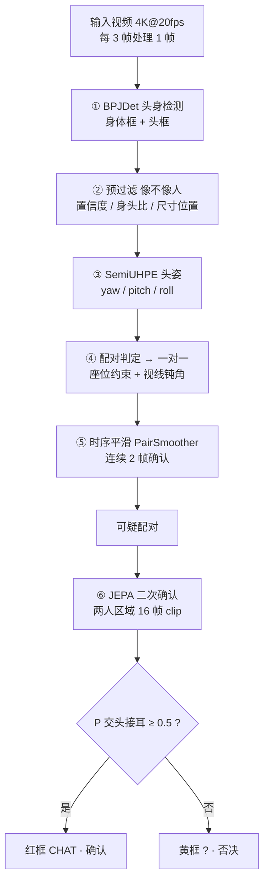

# 交头接耳检测 · 判别逻辑说明

> 版本：精简版 v1（两段式） · 更新日期：2026-09-27
> 入口脚本：`D:\chatting\SemiUHPE-main\video.py`

---

## 一、总体设计：两段式

核心思路是「**第一段只负责抓可疑，第二段只负责判真伪**」，设计原则为**宁可漏检，不要误判**。

- **第一段（几何 + 视线）**：用头身检测、座位约束、视线夹角等传统几何规则，快速筛出「可疑配对」。这一步宁可多抓、不可漏抓。
- **第二段（JEPA）**：把可疑配对的「两人区域」裁剪成 16 帧 clip，喂给自训练的 V-JEPA 二分类模型，判断是否真的在交头接耳。只有 JEPA 也判定为「交头接耳」才最终确认。

---

## 二、第一段：几何 + 视线（抓可疑）

### ① BPJDet 头身联合检测

YOLOv5-L（CrowdHuman 训练），检测「身体」和「长在身体上的头」。

| 参数 | 值 | 说明 |
|---|---|---|
| `IMGSZ` | 960 | 推理尺寸 |
| `CONF_THRES` | 0.50 | NMS 置信度阈值 |
| `IOU_THRES` | 0.75 | NMS IoU 阈值 |
| `MATCH_IOU_THRES` | 0.6 | 头框与身体框的关联 IoU |

### ② 预过滤「像不像人」（防椅子靠背被当人头）

| 条件 | 默认值 |
|---|---|
| 人头置信度 `HEAD_CONF_THRESH` | ≥ 0.65 |
| 身体置信度 `BODY_CONF_THRESH` | ≥ 0.62 |
| 身体最小高/宽 | 50 / 30 像素 |
| 身头比（身体高 ÷ 头高） | 2.5 ~ 8.0 |
| 头宽占图宽 | 0.015 ~ 0.35 |
| 头长宽比 | 0.5 ~ 1.8 |
| 头位置 | 在身体上半部、贴近身体顶部、水平不超出身体 ±25% |

### ③ SemiUHPE 头姿估计

ResNet50 + Fisher 分布，输出 `yaw / pitch / roll`。

> 符号约定：`ya = -yaw`，**ya > 0 = 向左看，ya < 0 = 向右看**。

### ④ 配对判定 → 一对一匹配

**座位约束**（同一排的左右邻座才会继续判）：

| 参数 | 值 | 含义 |
|---|---|---|
| `ROW_Y_RATIO` | 1.2 | 两头中心垂直差 ≤ 1.2 × 平均头高（排除前后排） |
| `SEAT_DIST_RATIO` | 0.35 | 水平距离 ≤ 0.35 × 图宽（邻座） |
| `NEIGHBOR_DX_RATIO` | 0.5 | 水平距离 ≥ 0.5 × 垂直距离（左右相邻而非前后） |

**视线钝角**（相互对看）：

| 参数 | 值 | 含义 |
|---|---|---|
| `MIN_TURN_YAW` | 10° | 每人都至少转头 10°（没转头不可能在说话） |
| 方向检查 | — | 左者向右看（ya<0）、右者向左看（ya>0），双方都朝对方 |
| `GAZE_OBTUSE_THRESH` | 100° | 视线夹角 ≥ 100° 判为「相互对看」 |

**一对一匹配**：按夹角降序贪心，一个人只配一个人。

### ⑤ 时序平滑 `PairSmoother`（跨帧确认，不用追踪器）

靠头中心就近认领「同一个配对」，压掉单帧偶发误判。

| 参数 | 值 | 含义 |
|---|---|---|
| `SMOOTH_ENABLE` | True | 关闭即退回「单帧命中即输出」 |
| `SMOOTH_CONFIRM_FRAMES` | 2 | 同一配对连续命中 2 个处理帧才确认 |
| `SMOOTH_HOLD_FRAMES` | 2 | 确认后容忍 2 帧漏检（防闪烁） |
| `SMOOTH_MATCH_DIST` | 0.8 | 跨帧匹配上限 = 0.8 × 平均头高 |

产出结果：**「可疑配对」**，附带稳定 `track_id`。

---

## 三、第二段：JEPA 判真伪（确认）

### ⑥ JEPA 二次确认

| 参数 | 值 | 含义 |
|---|---|---|
| `JEPA_ENABLE` | True | 关闭即退回只靠视线夹角的旧版 |
| `JEPA_CONFIRM_THRESH` | 0.5 | P(交头接耳) ≥ 该值才最终确认 |
| `JEPA_FRAMES` | 16 | 采样帧数 |
| `JEPA_FRAME_STEP` | 4 | 帧步长，16×4=64 帧 ≈ 3.2 秒时间窗 |
| `JEPA_BUF_MAX` | 64 | 720p 帧缓冲上限（原始帧数） |
| `JEPA_RERUN_INTERVAL` | 60 | 同一配对每隔 60 帧才重跑一次 JEPA（节流） |
| `JEPA_CROP_MARGIN` | 0.25 | 两人区域外扩比例 |

**模型**：V-JEPA(vit_large) 冻结主干 + AttentiveClassifier 分类头，二分类 `chatting`（交头接耳）/ `not_chatting`（正常）。

- 主干权重：`D:\jepa-main\pretrained_weights\vitl16.pth.tar`
- 分类头权重：`D:\jepa-main\pretrained_weights\video_classification_frozen\ssv2-16x2x3\jepa-best.pth.tar`（val_acc ≈ 98%）

**输入**：对可疑配对，取「两人区域」（身体框并集 + 外扩 25%），在 720p 帧缓冲里采样 16 帧，resize 到 224×224，输出 P(交头接耳)。

---

## 四、最终输出

| 标注 | 含义 |
|---|---|
| 红框 `CHAT` | 视线夹角可疑 + JEPA 确认 → 判定为交头接耳 |
| 黄框 `?` | 视线夹角可疑但被 JEPA 否决 → 不判为交头接耳 |

输出统计：`原始 N 对次 → 可疑 M 对次 → JEPA确认 K 对次`。

---

## 五、调节优先级

按对结果影响从大到小：

1. `GAZE_OBTUSE_THRESH`（100°，第一段主要闸门，建议 90~130）
2. `JEPA_CONFIRM_THRESH`（0.5，第二段闸门，调高更严、宁漏勿误）
3. `SMOOTH_CONFIRM_FRAMES`（2，时序确认帧数）
4. `HEAD_CONF_THRESH`（0.65，压误检）

---

## 六、环境与运行

- 运行环境：conda `yolo` 环境（Python 3.10 + torch 2.13 + CUDA）
- 运行方式：`cd D:\chatting\SemiUHPE-main && python video.py`
- 输入视频：`D:\video\1\1\right\cutting_video2`（8 个 4K mp4）
- 输出目录：`D:\chatting\outputs`

> 注意：JEPA 模型是在**全画面**监控切片上训练的，而第二阶段目前喂的是**两人裁剪区**。若实测发现 JEPA 误杀/漏放明显，可考虑把输入从「裁剪」切回「全画面」。
